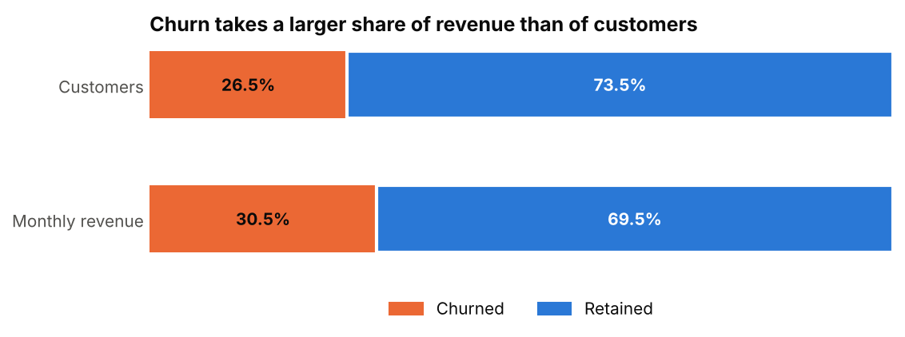
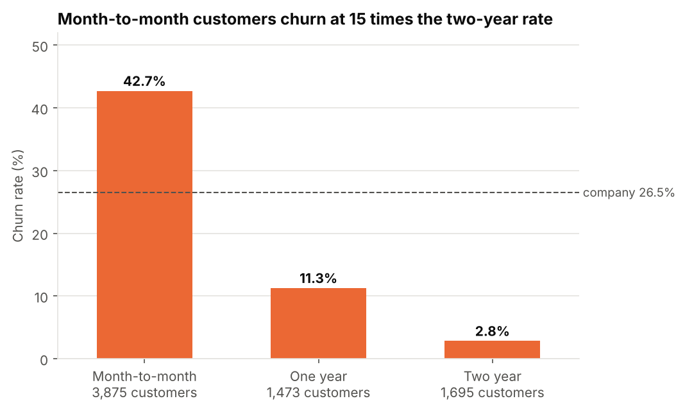
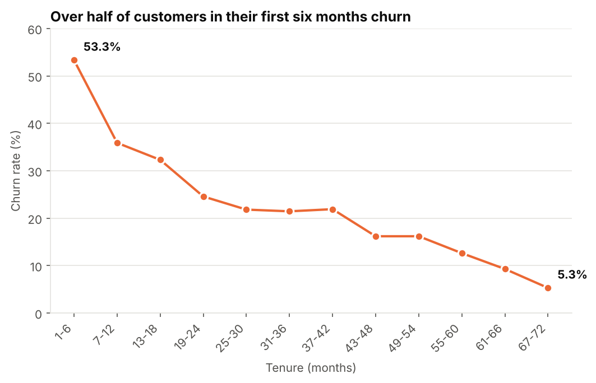
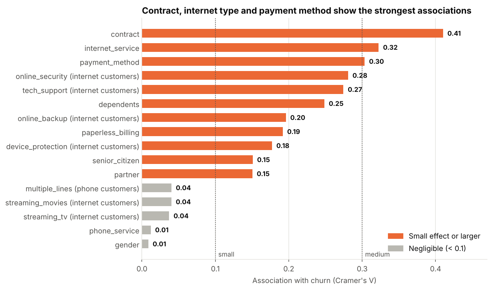

# Customer Churn Intelligence & Retention Analytics

An end-to-end analysis of customer churn for a telecom company: data cleaning, SQL, exploratory analysis, statistical testing, feature engineering, a baseline prediction model, a Power BI dashboard design, and an executive summary with evidence-based recommendations.

The goal was to answer a business question with defensible evidence, not to maximise a model score. Every finding is an **association in a single snapshot**, and the project says so wherever it matters.



## Business problem

A telecom company is losing customers and wants to know:

1. What is the churn rate?
2. Which customer segments churn most?
3. Which factors are most strongly associated with churn?
4. Which customers or profiles look most at risk?
5. What is the revenue impact?
6. What should the company do, based on the evidence?

## Objectives

- Clean and validate a raw customer dataset with every decision justified.
- Answer the business questions with SQL and Python.
- Separate statistical significance, business significance and causation.
- Engineer interpretable features and test whether they actually work.
- Test whether churn risk can be predicted well enough to support action.
- Present the result for a non-technical audience.

## Dataset

- **Source:** IBM Telco Customer Churn sample dataset (the extended version with churn reason, churn score and CLTV), widely mirrored on Kaggle. Check the terms of the source you download it from.
- **Size:** 7,043 customers x 33 columns, one row per customer.
- **Content:** demographics, location, tenure, phone/internet services and add-ons, contract, billing, payment method, monthly and total charges, churn label, churn reason.
- **Nature:** synthetic, California only, a single snapshot with no dates.
- **Raw file:** `data/raw/customer_churn_raw.csv` is a straight, unmodified export of the original Excel file (all values kept as text). It is never edited.

## Tools

Python (pandas, NumPy, SciPy, scikit-learn, Matplotlib), Jupyter, SQL (SQLite), Power BI Desktop (DAX).

## Workflow

```
data/raw/customer_churn_raw.csv   (never modified)
        |  cleaning (notebook, Phase 3)
        v
data/clean/customer_churn_clean.csv  --> feature engineering (+9 columns)
        |                |                       |
        v                v                       v
   SQL (sql/)     EDA, statistics, model     Power BI (powerbi/)
                  (notebook)
        \                |                       /
         ----> reports/executive_summary.md <----
```

## Cleaning process

The raw file is already fairly tidy: no duplicate rows or IDs, no stray whitespace, no impossible values. The decisions that did matter (each documented as Problem -> Evidence -> Decision -> Result in the notebook):

| Issue | Decision |
|---|---|
| `Total Charges` stored as text; 11 blank cells | Convert to a number; set the blanks to 0. All 11 are new customers (tenure 0) who have not been billed. Not dropped, not mean-imputed. |
| "No internet service" / "No phone service" repeated in 7 columns | Recoded to "No"; the information is already in `internet_service` and `phone_service`. |
| `count`, `country`, `state` constant; `lat_long` duplicates latitude and longitude | Dropped after asserting they are redundant. |
| Column names with spaces | Converted to `snake_case`. |
| `zip_code` | Kept as text (an identifier). |
| `churn_reason` empty for 5,174 customers | Left empty: they did not churn. Flagged as a leakage risk for modelling. |
| Outliers | None removed; monthly charges and tenure are bounded and plausible. |

The cleaned data is verified by reloading the exported CSV independently.

## SQL analysis

Five files in `sql/`, run on SQLite, each query answering a stated business question (with the result and interpretation written in the comments):

| File | Content |
|---|---|
| `01_data_validation.sql` | Row and key checks, nulls, churn-column agreement, invalid ranges |
| `02_customer_analysis.sql` | Churn rate; by contract, payment method, internet type, household segment; churned vs retained charges |
| `03_churn_kpis.sql` | Revenue lost, above-average-risk segments (HAVING, subquery), revenue at risk (CTE) |
| `04_segmentation.sql` | Tenure and value segments, churn-reason themes (JOIN to a lookup table), highest-risk profiles |
| `05_advanced_analysis.sql` | RANK/DENSE_RANK, ROW_NUMBER call list, LAG across tenure years, Pareto of lost revenue |

## Python analysis

Eight charts, each tied to a question (see the notebook, Phase 5). Examples:




## Statistical analysis

- Wilson 95% confidence intervals for churn rates.
- Chi-square tests with Cramér's V for 16 categorical variables, with a Bonferroni correction.
- Welch t-test and Mann-Whitney U with Cohen's d for tenure and charges; Spearman correlation.
- A stratified comparison showing that the "churners pay more" result reverses within each internet type.
- Risk difference with a confidence interval for the month-to-month gap.



## Feature engineering and prediction

Nine features were added (tenure band, protection count, value segment, a five-flag risk scorecard, revenue at risk, and others). One of them, total `service_count`, did **not** work, and the notebook shows why. A logistic regression and a random forest were compared with cross-validation and evaluated once on a held-out test set. Leakage-prone columns (`churn_score`, `churn_reason`, `cltv`, outcome-derived features) were excluded, and the notebook shows how much a leaky model overstates performance.

| Model | Test ROC-AUC |
|---|---|
| Logistic Regression | 0.847 |
| Random Forest | 0.854 |
| Five-flag risk scorecard | 0.815 |

Churn can be **ranked** reasonably well (contacting the top 20% by predicted risk reaches about half of churners), but not predicted with certainty, and the models are only modestly better than the simple scorecard.

## Power BI dashboard

Three pages: Executive Overview (6 KPIs and four churn breakdowns), Churn Drivers, and Customer Segments (high-value, high-risk groups). The build guide, DAX measures with explanations, a colour theme and the expected values for validation are in `powerbi/`.

<!-- After building the dashboard, add a screenshot as images/dashboard_preview.png and uncomment the next line.

-->

## Key findings

- **26.5%** of customers churned; they accounted for **30.5%** of monthly revenue (about $139K a month).
- **Month-to-month** customers are 55% of customers but 89% of churners (42.7% churn vs 6.8% on other contracts).
- **Fiber optic** customers are 44% of customers, 69% of churners and 82% of lost revenue, and churn more than DSL under every contract type.
- The worst profile is **month-to-month, fiber, first 12 months**: 70% churn and 38% of lost revenue.
- Churners pay more overall, but **not more than peers on the same internet type**. Only 13% cite price as a reason; 33% cite a competitor and 20% cite support.
- Churn falls steadily with the number of **protection add-ons** held, from 56.7% to 5.3% among internet customers.
- Gender and phone service show no meaningful association with churn.

## Business recommendations

Written as tests, not as claims of cause (details and sizing in `reports/executive_summary.md`):

1. Randomised first-year retention offer for month-to-month fiber customers.
2. Investigate fiber competitiveness and reliability.
3. Randomised security/tech-support bundle trial for unprotected internet customers.
4. Review support quality.
5. Test moving electronic-check payers to automatic payment; use the risk ranking to prioritise outreach.

## Limitations

- One snapshot with no dates: no cohort or time analysis, and no test on future customers.
- Synthetic, single-state data; results should not be generalised.
- All findings are associations; the data cannot show cause.
- Revenue at risk is an estimate that assumes historical segment churn rates repeat.
- Churn reasons are self-reported and were grouped into themes by the author.
- Models are untuned and use one random split. The risk scorecard's flags were chosen using the same data, so its performance is optimistic.
- The Power BI file and its screenshot are built by hand in Power BI Desktop. Its numbers should be checked against the expected values in `powerbi/POWERBI_GUIDE.md`, which were computed independently in Python.

## Repository structure

```
customer-churn-intelligence/
├── data/
│   ├── raw/customer_churn_raw.csv            original data, never edited
│   └── clean/customer_churn_clean.csv        cleaned + engineered features (38 columns)
├── notebooks/customer_churn_analysis.ipynb   audit, cleaning, SQL runner, EDA, statistics, features, model
├── sql/                                      01-05 analysis scripts
├── powerbi/
│   ├── POWERBI_GUIDE.md                      build guide, DAX, validation values
│   ├── churn_theme.json                      colour theme
│   ├── churn_driver_effects.csv              Cramér's V table (from Python)
│   └── customer_churn_dashboard.pbix         the dashboard (built in Power BI Desktop)
├── images/                                   charts used in the notebook and README
├── reports/executive_summary.md              one-page business summary
├── README.md
└── requirements.txt
```

## How to reproduce

1. **Environment**

   ```bash
   python -m venv .venv && source .venv/bin/activate      # Windows: .venv\Scripts\activate
   pip install -r requirements.txt
   ```

2. **Notebook.** Start Jupyter inside the `notebooks/` folder (paths are relative to it), open `customer_churn_analysis.ipynb` and **Run All**. This regenerates `data/clean/customer_churn_clean.csv`, `powerbi/churn_driver_effects.csv` and the charts in `images/`. Random seeds are fixed, so results should match.

3. **SQL.** Load the clean CSV into SQLite with correct column types. The simplest way is the notebook's Phase 4 loader, or:

   ```python
   import sqlite3, pandas as pd
   con = sqlite3.connect('churn.db')
   pd.read_csv('data/clean/customer_churn_clean.csv', dtype={'zip_code': str}).to_sql('customers', con, index=False, if_exists='replace')
   ```

   Then run the files in `sql/` in order. (Avoid the sqlite3 command-line `.import` without declaring types: numbers would load as text and comparisons such as `monthly_charges < 35` would give wrong results.)

4. **Power BI.** Follow `powerbi/POWERBI_GUIDE.md`, then check your numbers against its validation table.
